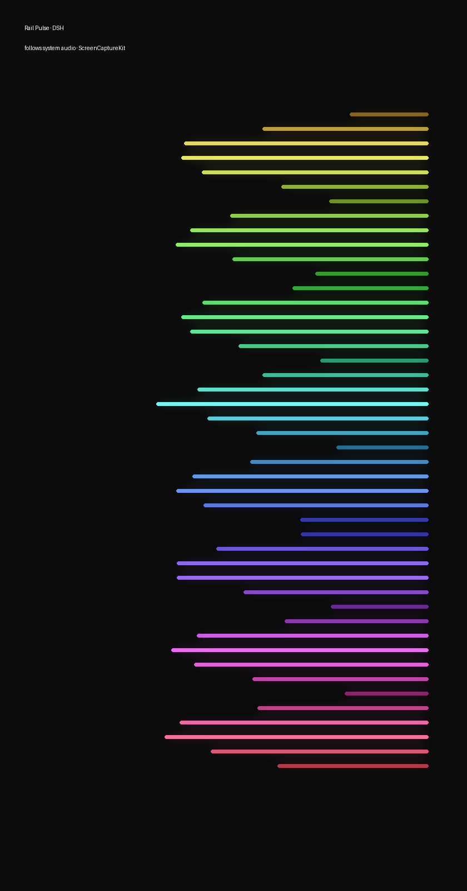

# dsh-rail-pulse

> **平台支持：目前仅支持 macOS（Apple Silicon / arm64）。**
> Windows 和 Linux 暂未提供音频采集器；界面与配置是跨平台的，移植需要实现对应平台的 loopback 采集（Windows: WASAPI Loopback）。详见文末「平台支持」。

给 DeepSeek Harness（DSH）右侧加一条**跟随电脑系统音频跳动**的频谱条。



## 特性

- **系统音频直采**：用 macOS CoreAudio Process Tap 采集系统播放声音，不需要 BlackHole，也不触发屏幕录制提示（旧系统自动回退 ScreenCaptureKit）
- **46 段频谱**：Hann 窗 + vDSP 512 点 FFT，对数频段 + 逐段 AGC，带平滑与空段填补
- **彩虹 / 单色**：默认彩虹渐变、色相缓慢流动；面板里可切单色并自选颜色
- **浮窗设置**：长条右下角 `♪` 打开，含显示开关、灵敏度、起伏、尺寸、平滑、炫彩开关、自定义单色
- **配置持久化**：保存在 `~/.dsh/rail-pulse/config.json`
- **默认不打扰**：`shell.overlay` 浮层默认 click-through，只有设置按钮接收点击

## 要求

- macOS 14.2 及以上（CoreAudio Process Tap；低版本自动回退 ScreenCaptureKit，需要「屏幕录制」权限）
- DeepSeek Harness 桌面版 0.2.x
- 重新编译原生采集器需要 Xcode Command Line Tools

## 安装

### 方式一：本地安装（开发/自用）

```bash
git clone https://github.com/l1625116707-cmyk/dsh-rail-pulse.git
cd dsh-rail-pulse
./scripts/build.sh   # 重新编译 bin/railpulse-tap 与 bin/railpulse-audio（仓库已带 arm64 预编译）
```

在 DSH 里用插件管理器安装这个目录，或：

```bash
dsh plugin --profile desktop add /绝对路径/dsh-rail-pulse
```

### 方式二：从 GitHub 安装

```bash
dsh plugin --profile desktop add github:l1625116707-cmyk/dsh-rail-pulse
```

装好后刷新 DSH 页面（`Cmd+R`）。

## 使用

1. 右侧出现一条竖排频谱条
2. 点右下角 `♪` 打开浮窗
3. 可调：显示/隐藏、灵敏度、起伏、尺寸、平滑、炫彩色、自定义单色
4. 播放任意系统声音（音乐、视频、会议）即可看到律动

## 配置

运行时接口：

- `GET /rail-pulse/levels`：最新频谱 `{ "bands": [...], "t": ... }`
- `GET/POST /rail-pulse/config`：`{ visible, gain, scale, motion, smoothing, colorful, color }`

配置文件：`~/.dsh/rail-pulse/config.json`

## 原生采集器

`native/railpulse-tap.swift`（首选，CoreAudio Process Tap）与 `native/railpulse-audio.swift`（回退，ScreenCaptureKit）由 host 插件以子进程方式拉起，读取系统音频并逐行输出 JSON：

```json
{"bands":[0.12,0.35,...],"t":1795525475.7}
```

它只读取音频采样做频谱计算，不保存、不上传音频。

```bash
./scripts/build.sh
```

## 许可

MIT

## 平台支持

| 平台 | 状态 | 说明 |
|---|---|---|
| macOS (arm64) | ✅ 支持 | CoreAudio Process Tap 采集；旧系统回退 ScreenCaptureKit |
| macOS (Intel) | ⚠️ 未测试 | 仓库内二进制为 arm64，需要本地重新 `./scripts/build.sh` |
| Windows | ❌ 暂不支持 | 需要新增 WASAPI Loopback 采集器与 `build.ps1` |
| Linux | ❌ 暂不支持 | 需要 PulseAudio/PipeWire monitor 采集器 |

插件界面、配置接口和频谱绘制是跨平台的；缺的是各平台的系统音频采集二进制。
